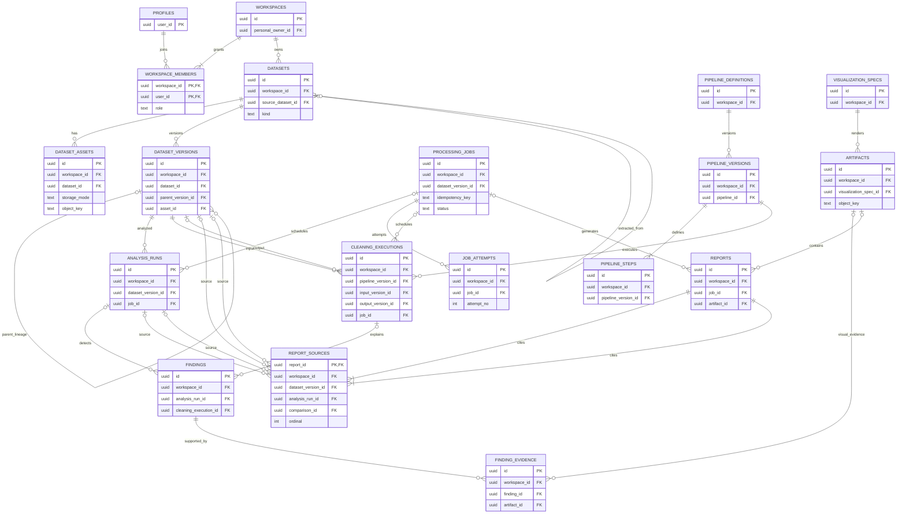
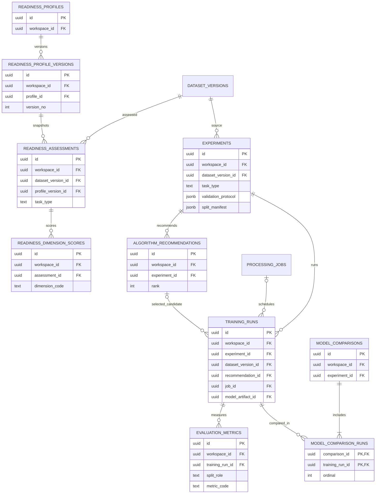
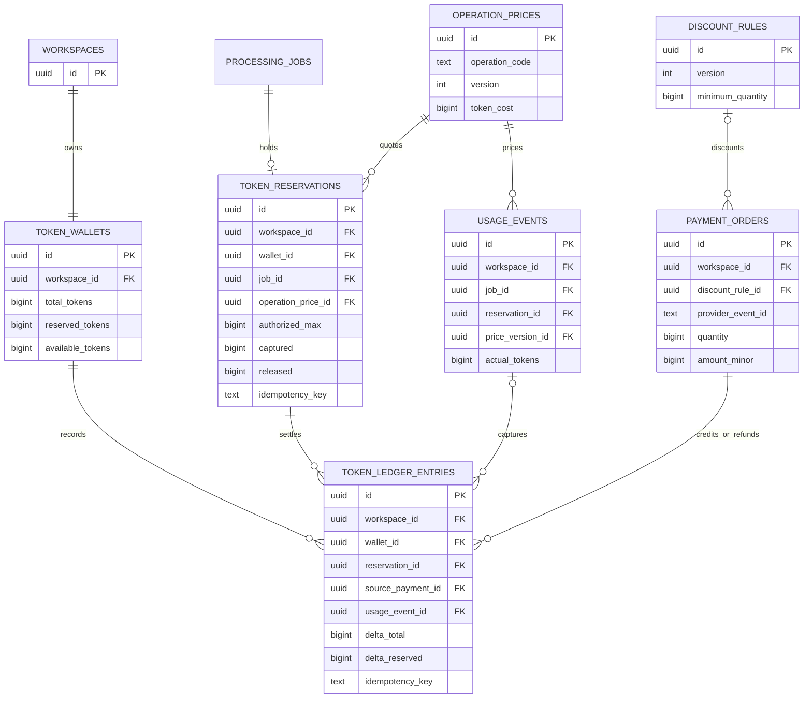

# NUMPA v2 — Plan 2: Database and Storage Architecture

## Status and recommendation

**Status:** Draft for review. This is an architecture proposal, not an approved physical schema. It establishes no migrations, code, packages, prices, limits, or retention periods.

**Recommendation:** Supabase PostgreSQL for structured state, Supabase Auth for identity, and private Supabase Storage as the initial cloud object store. Every user-owned record belongs to a workspace. Begin with personal workspaces and retain a membership model that supports later organization workspaces. Browser-only file bytes remain on-device and need no cloud dataset, version, or object row unless the user explicitly chooses to save cloud history or processing. Store immutable input/configuration snapshots and provenance references so runs remain explainable.

Use UUIDs for application keys; Auth user UUIDs for identities; UTC timestamps; integer byte counts; constrained lifecycle/status values; and bounded, versioned JSONB only for variable configuration/evidence. Every tenant record carries workspace_id for direct RLS enforcement. Use composite uniqueness/foreign keys on (workspace_id,id) where needed to prevent cross-workspace references. created_by is attribution, not ownership. Full table/column inventory is in the [data dictionary](../database/data-dictionary.md).

## 1. Storage boundaries

| System | Responsibility | Not responsible for |
|---|---|---|
| Supabase Auth | Authentication credentials, identity and session lifecycle. profiles.user_id maps one-to-one to auth.users.id. | Passwords, refresh tokens, or copied credentials in app tables. |
| PostgreSQL | Workspace/access state; dataset and file metadata; versions and lineage; run/job state; findings/evidence; metrics; artifact references; audit events; billing configuration snapshots, wallet, reservations, and ledger. | Raw files, dataframes, PDFs, images, model binaries, or unbounded logs. |
| Supabase Storage | Initial private object store for cloud uploads, canonical/cleaned dataset versions, generated reports/charts, and retained model artifacts. | Public data buckets or authorization based on an opaque path alone. |
| Browser local | User-selected local processing, transient data in memory, optional explicit device-local persistence. | Account history/recovery claims or silent cloud upload. |
| Job infrastructure | Replaceable queue/worker executes tasks. PostgreSQL records durable job identity, status, attempts, and output references. | Queue as sole source of truth or large payloads in job rows. |

Supabase Storage private buckets are the recommended initial approach; avoid adding another storage vendor until requirements prove necessary. Use a small number of private buckets separated by lifecycle/trust boundary if useful, never a bucket per user. Generate opaque object keys from workspace/dataset/version/asset UUIDs, not filenames or personal data. Metadata records bucket, key, size, MIME type, checksum, and state.

A trusted API creates an upload intent, authorizes workspace access, issues a short-lived signed URL, verifies upload and content, then finalizes the asset/version row. A signed URL is a bearer credential: expire quickly, avoid logging it, never embed it in reports, and issue only after checking current membership. Storage policies and RLS must both enforce workspace access. Never expose service-role keys to clients. Pending/abandoned uploads are cleaned by an idempotent reconciliation job. Deletion first revokes access and marks pending deletion, then deletes objects asynchronously and records completion; a sweep finds orphaned objects.

### Browser-only behavior

By default, browser-only bytes and working state create no cloud file/dataset rows. Session-only memory cannot survive refresh; optional IndexedDB persistence can survive some refreshes but may be cleared, evicted, or lost with the device/profile. Do not promise recovery beyond what the browser stores. Cloud account history, cross-device recovery, and server-side report generation requiring the raw file are unavailable unless the user explicitly saves/uploads it. A local report can be generated and downloaded. Metadata/results may be saved without raw bytes only with clear disclosure that profiles and findings may reveal sensitive facts. Failure before local persistence may be unrecoverable. Plan 6 and product review must choose session-only vs optional IndexedDB behavior.

### Auth and account lifecycle

profiles references auth.users.id and holds only minimal preferences/lifecycle fields. A trusted Auth lifecycle process provisions it; users cannot set user_id or role. Auth deletion must not cascade directly into financial/audit history. Account closure blocks new work, revokes credentials, cancels jobs, then follows approved deletion/anonymization and retention policy. Workspace ownership transfer/deletion must be explicit and never leave an orphaned accessible workspace.

## 2. Candidate model and workflow support

All tenant rows have workspace_id. Main MVP families:

- Identity/access: profiles, workspaces, workspace_members.
- Ingestion: datasets, dataset_assets, dataset_versions.
- Work/audit: processing_jobs, job_attempts, analysis_runs, findings, finding_evidence, pipeline_definitions, pipeline_versions, pipeline_steps, cleaning_executions.
- Visualization/artifacts: visualization_specs, artifacts, reports, report_sources.
- ML: readiness_profiles, readiness_profile_versions, readiness_assessments, readiness_dimension_scores, experiments, algorithm_recommendations, training_runs, evaluation_metrics, model_comparisons.
- Billing when paid execution launches: token_wallets, token_ledger_entries, operation_prices, discount_rules, payment_orders, token_reservations, usage_events.
- Later: organizations if distinct from org workspaces, API credentials/metering, integrations/webhooks, white-label config, subscriptions/entitlements, feedback.

A dataset is a logical source or structured dataset; datasets.kind distinguishes them. An uploaded PDF is a source document asset. Extracted table candidates are child datasets with extraction status and metadata. Multiple tables become independent candidates; failed/ambiguous extraction is represented as status/findings, not a fake table. A canonical tabular version exists only after selection/conversion. A cleaned version is immutable, points to its parent version and cleaning execution, and never overwrites the source.

| Plan 1 workflow | Data representation |
|---|---|
| Upload/validation | Cloud: dataset, private asset, version metadata and ingestion job/findings. Browser: local state, no cloud row by default. |
| Analysis | analysis_runs, bounded profile, findings/evidence; local result may remain local or be explicitly saved. |
| Cleaning | versioned pipeline/steps, cleaning execution, input/output version refs, step outcomes and bounded before/after summaries. |
| Visualization | specification and optional artifact metadata; transient charts need no row. |
| Readiness | versioned profile and assessment snapshot with dimension scores/evidence. |
| Recommend four | recommendation snapshots with rationale, assumptions, model family/version and rank; fewer than four allowed when appropriate. |
| Train/evaluate | experiment, training run, protocol/split metadata, metrics and exact dataset/config versions. Keep train/validation/test roles distinct; avoid raw split/prediction storage by default. |
| Compare/report | comparison references exact runs/metric basis; report references source runs, dataset versions and template plus private artifact. |

Persist profile summaries, not raw rows. Use typed columns and foreign keys for authorization, lifecycle, and joins; bounded JSONB for variable parameters and evidence. Move large payloads to Storage. Config and result rows are immutable once published/completed. Changes create a new pipeline/profile version; completed assessments retain the version they used.

### Task-specific experiment and evaluation safeguards

The experiment snapshot must be task-discriminated, not one universal split recipe. Classification records target/label selection and an appropriate stratification/grouping policy when used. Regression records target and split strategy. Forecasting records the time column, ordering and timezone interpretation, forecast horizon, frequency/resampling assumptions, forecast origins, gap/embargo and rolling/expanding validation windows; each fold trains only on observations earlier than its validation/test window. Clustering has no supervised target and records feature inclusion, distance/preprocessing choices and any stability protocol. These can be normalized or held in a versioned task_config document, but validation must be task-specific.

Each experiment freezes dataset_version_id, task type, target/feature specification, validation protocol, split manifest, configuration hash, algorithm/software version and randomization settings where meaningful. Training and evaluation records reference that experiment and exact dataset version. Store split roles and time boundaries without copying row-level data. Training metrics, validation metrics used for selection, and held-out test metrics are distinct records; test data must not influence tuning. Forecast folds preserve temporal order and avoid future leakage. Clustering records unsupervised evaluation definitions and does not invent target metrics. Completed metrics and protocol snapshots cannot be edited; corrections create a new run.

## 3. ER diagrams

The following Mermaid diagrams split the MVP into readable domains. The FK fields shown are essential references; workspace_id on tenant tables is a same-workspace composite FK dimension in addition to each parent FK. A relationship means a declared FK unless specifically marked as lineage or a normalized join. Nullable FKs represent optional stages (for example a local-only run may not have a cloud dataset version).

### Identity, ingestion, processing, analysis, cleaning, and exports

### Readiness and model experiments

### Token economy and payment

Diagram constraints: AUTH users are Supabase-managed and shown as PROFILES' external FK rather than an application entity. Dataset self-lineage is one-way parent_version_id; cleaning execution points to input/output versions, avoiding a reciprocal produced_by FK. Extracted child datasets use source_dataset_id. A PDF candidate can point to a child dataset only after successful extraction. Ledger entries use typed nullable FKs and a CHECK enforcing the permitted source combination; they do not depend on arbitrary type/id pairs. Composite workspace FKs are summarized above and detailed in the data dictionary.

## 4. Ownership and provenance

| Records | Tenant and actor | Required provenance |
|---|---|---|
| Workspace | workspace is root; personal owner/org scope | created_by |
| Membership | workspace_id + member user_id | invited_by |
| Dataset/assets/versions | workspace_id; created_by is actor | dataset, asset, parent version, object key |
| Runs/findings/evidence | same workspace as run | exact dataset version, job, config version |
| Pipeline | workspace; editor attribution | definition → immutable version → ordered steps |
| Cleaning | workspace; requester/worker attribution | input/output versions, pipeline version, job |
| Visualization/report/artifact | workspace; requester | source version/run and artifact |
| Readiness | workspace; requester | exact profile version and dataset version |
| Experiment/training/metrics/compare | workspace; requester/worker | dataset version, protocol/config snapshot, run refs |
| Jobs/attempts/events | workspace; requester/service | idempotency key and operation target |
| Wallet/ledger/payment/reservation/usage | workspace billing scope; trusted actor | job, quote/price snapshot, payment/source, reservation |
| Later API/integration | workspace; credential creator | hashed key or encrypted secret reference |

Do not repeat owner_user_id on every child row. Membership determines access; created_by is attribution only. Include workspace_id on children for direct RLS and composite same-tenant FKs, a deliberate security/performance duplication.

## 5. Token ledger and concurrency

The wallet is a cached balance for display/locking, never the billing truth. Append-only ledger entries contain signed integer token delta, event type, source FK, unique idempotency key, trusted actor, timestamp, and quote/price snapshot. Posted entries are never edited/deleted; corrections use compensating entries. Store money as integer minor units plus ISO currency. Version operation prices and quantity discount tiers with effective dates. A quote snapshots quantity, tier, base/discount/final amount and currency; later price changes affect only new quotes.

Wallet balances are distinct: total_tokens is the net token balance after captured spend and reversals but before active holds; reserved_tokens is held for unsettled work; available_tokens = total_tokens - reserved_tokens. All must remain nonnegative. Reserve increases reserved and decreases available without changing total. Capture decreases total and reserved by the captured amount; release decreases reserved only. Purchase/bonus credits increase total. Refunds/chargebacks are compensating ledger events; never silently clamp a negative result.

Reservation lifecycle: estimate → reserve → execute → capture actual authorized cost and release unused amount on success; release on failure/cancel unless reviewed policy permits charging completed partial work. Any charge above authorization requires new user consent. Reservation states include reserved, partially captured, captured, released, and expired only if policy allows. Unique payment provider/event IDs prevent duplicate webhook credits. Refunds/chargebacks create compensating ledger movements. Retries share one logical job/reservation; attempts do not independently charge. Unique reservation transition/idempotency keys prevent repeated capture.

In one transaction, lock wallet or use serializable/atomic SQL routine; verify available balance, insert reservation and ledger hold, update cache; enforce nonnegative result. On terminal job transition, capture/release, post unique ledger movement, update wallet and reservation atomically. Payment verification and operation-price writes are backend-only. Reconcile cached balance against ledger and create an audited adjustment only after investigation. Discount threshold, prices, token costs, expiration, partial billing, reservation timeout, and chargeback policy are undecided.

## 6. Jobs, RLS, and security

processing_jobs stores workspace, operation, target refs, requester, status, bounded progress, idempotency key, request/config hash, cancel request, timestamps and sanitized terminal error. job_attempts stores attempt number, lease/worker, timings and sanitized outcome. Optional job_events is append-only for significant transitions. Payloads/files remain in private storage or a protected payload store. Unique (workspace_id,idempotency_key), lease/compare-and-set claims, output uniqueness by job+role, and terminal-state immutability make retries safe. Cancellation is a request until acknowledged. Plan 3 selects queue, lease, outbox and event mechanism.

All exposed tenant tables enable RLS and check active workspace membership/role using a reviewed helper with fixed search_path. Personal owner is an owner membership, allowing the same policy to extend to organizations. Revoke broad grants; review views/functions for RLS bypass.

| Table group | Read | Client writes | Trusted backend |
|---|---|---|---|
| Profiles | own | safe preferences only | Auth lifecycle |
| Workspaces/members | members | owner/admin membership operations; no role escalation | invite/owner invariants |
| Datasets/files/versions | authorized members | create metadata/upload intent; draft metadata only | verify/finalize/delete |
| Pipelines/readiness profiles | members | draft editor changes only | freeze versions |
| Jobs/runs/results/metrics | members | request work only | worker state/results |
| Artifacts/reports | members, with authorized download | request generation | sign URLs/write/delete |
| Audit | authorized admins/support | no edit/delete | privileged events |
| Wallet/ledger/prices/payments/reservations/usage | scoped history/read | no financial writes | trusted billing service only |
| Future credentials/integrations | admin or credential owner; never secret plaintext | create/revoke request | hashes/encrypted secret refs |

### MVP table-by-table RLS permissions

“Member” means active workspace membership; “editor” means the owner/admin/editor role. Client mutations should normally be authenticated API requests, not direct table grants. RLS checks tenant membership; grants and trusted API checks restrict writable columns and transitions.

| MVP table | Read | Insert | Update | Delete |
|---|---|---|---|---|
| profiles | Own profile | Auth lifecycle only | Own allowlisted preferences; identity fields backend-only | Backend account lifecycle |
| workspaces | Active members | User requests personal workspace; backend enforces owner invariant | Owner/admin safe metadata; ownership/kind transitions backend-only | Backend deletion workflow |
| workspace_members | Active members; invitee sees own pending invite | Owner/admin invite or trusted acceptance | Owner/admin role/status; no self-escalation; backend last-owner check | Owner/admin removal or account-closure backend |
| datasets | Active members | Authorized member via API | Editor renames drafts; lifecycle backend | Backend soft-delete workflow |
| dataset_assets | Authorized members see metadata | Member requests upload intent; backend creates pending record | Backend verifies/finalizes only | Backend deletion/reconciliation |
| dataset_versions | Authorized members | Backend finalizes version only | Never after finalization | Backend dependency-aware deletion |
| processing_jobs | Members, sanitized errors | Member requests through API | Backend/worker only; terminal state frozen | Backend retention only |
| job_attempts | Members, sanitized detail | Backend/worker only | Backend/worker finalizes attempt | Backend retention only |
| analysis_runs | Members | Member requests analysis through API | Backend/worker; completed result frozen | Backend deletion workflow |
| findings | Members authorized for parent | Backend/worker only | Content immutable; user disposition is a separate audited transition | Backend parent retention |
| finding_evidence | Same as finding | Backend/worker only | Never after insertion | Backend with finding/artifact |
| pipeline_definitions | Workspace members | Editor creates draft | Editor edits draft metadata | Editor may archive; physical deletion backend only if unreferenced |
| pipeline_versions | Workspace members | Editor requests; backend creates/publishes | Draft only; published version protected | No client delete; backend only if unreferenced |
| pipeline_steps | Members of parent workspace | Editor on draft only | Editor on draft only | Editor on draft only; published steps frozen |
| cleaning_executions | Workspace members | Member requests; backend creates | Backend/worker while running; terminal frozen | Backend dependency-aware retention |
| visualization_specs | Workspace members | Member/editor | Creator/editor may change draft | Creator/editor request; backend checks dependencies |
| artifacts | Members see metadata; download separately authorized | Backend only | Backend lifecycle only; ready object identity frozen | Backend deletion/reconciliation only |
| reports | Workspace members | Member requests; backend creates | Backend/worker status only; ready provenance frozen | Backend retention/deletion workflow |
| report_sources | Members authorized for report | Backend inserts typed provenance links | Never after report ready | Backend with report/source retention |
| audit_events | Workspace owner/admin; restricted audited support | Trusted service only | Never | No client delete; approved retention purge only |
| readiness_profiles | Workspace members | Editor creates draft | Editor draft only | Archive; physical delete backend if unreferenced |
| readiness_profile_versions | Members | Editor requests, backend creates/publishes | Draft only; published protected | No client delete when referenced |
| readiness_assessments | Workspace members | Member requests; backend writes | Backend while running; completed frozen | Backend deletion workflow |
| readiness_dimension_scores | Members authorized for assessment | Backend/worker only | Never | Backend with assessment |
| experiments | Workspace members | Member creates via API | Creator/editor draft only; freeze before training | Draft only if no runs; backend enforces |
| algorithm_recommendations | Members authorized for experiment | Backend/worker only | Never after creation | Backend with experiment |
| training_runs | Workspace members | Member requests; backend creates | Worker/backend transitions; terminal frozen | Backend with experiment/artifact lifecycle |
| evaluation_metrics | Members authorized for run | Worker/backend only | Never after completion | Backend with run |
| model_comparisons | Workspace members | Member requests; backend validates run set | Never after creation | Backend with experiment |
| model_comparison_runs | Members via comparison | Backend only | Never after creation | Backend with comparison |
| token_wallets | Members read scoped summary | Backend bootstrap only | Atomic billing routine only | Never by client |
| token_ledger_entries | Members read scoped history | Trusted billing routine only | Never; correction is a compensating entry | Never by client |
| operation_prices | Published quote values | Trusted admin/backend only | New version only | No delete when referenced |
| discount_rules | Published tiers | Trusted admin/backend only | New effective version only | No delete when referenced |
| payment_orders | Workspace members read scoped order | Backend creates | Verified provider webhook/backend only | Never by client |
| token_reservations | Members read scoped reservation | Billing routine only | Billing routine/job settlement only | Never by client |
| usage_events | Members read scoped usage | Backend operation finalizer only | Never after posting | Never by client |

These permissions do not replace API checks for every referenced resource. Same-workspace composite FKs prevent cross-tenant references even if an attacker guesses a UUID. Storage policies independently check workspace membership and object metadata association; database RLS alone does not authorize bytes.

Server service-role credentials bypass RLS and belong only in backend secret storage, never browser or logs; rotate and audit use. API authorization must validate workspace role and each referenced object. Storage policies complement RLS by checking membership/object metadata association. A private DB row must never map to public URL. Signed URLs are short-lived bearer credentials.

Minimize profile data, log no raw file contents/secrets/signed URLs, sanitize worker errors, and bound evidence/result JSON. Deletion requests block access and new work, cancel active jobs, revoke signing, remove objects asynchronously, then purge/anonymize DB records by approved retention rules. Keep required billing/audit records only for reviewed purposes/durations.

## 7. Lifecycle, reliability, and retention

Retention durations, legal holds, region, backup windows, deletion SLA and recovery objectives remain undecided; see [storage matrix](../database/storage-and-retention-matrix.md).

- Upload: pending intent → private upload → format/size/content validation → verified metadata/version. DB and object storage do not share a transaction, so reconcile pending rows and orphan objects.
- Browser-only: local memory or explicitly persistent browser storage. Refresh/device recovery only when bytes/config remain locally; no account recovery promise.
- Cloud dataset: private object and immutable version metadata/checksum.
- Cleaning: write a new immutable output object/version and lineage; preserve source until approved retention deletion.
- Analysis/readiness: save bounded results and exact input/config snapshot; no raw per-row outputs by default.
- Training: save config/protocol/results; retain model binary only when supported and user-visible.
- Report: provenance row plus private file; local report download need not be stored server side.
- Failed/cancelled work: sanitized terminal record, idempotent partial-output cleanup, honest status and billing policy.
- Deletion: logical revoke first, physical deletion asynchronously, status tracking, orphan sweep; dependent lineage deletion explained before action.

Use FKs/checks/unique constraints and transactions for integrity. Index workspace+created_at, common FK columns, active status/queue claims, and idempotency keys; add JSON indexes only for demonstrated queries. Bound JSONB and metadata sizes. Use reviewed forward migrations, staging validation, backup and rollback/backfill plans. Plan 6/7 must define backup/PITR tier, RPO/RTO and restore drills. Plan 3 defines reliable queue dispatch/outbox and reconciliation jobs.

## 8. MVP and later phases

| Area | MVP | Later |
|---|---|---|
| Access | Auth mapping, profile, personal workspace, membership table | Organizations, invites, enterprise SSO/policies |
| Ingestion | Cloud object metadata/versioning and browser-local path; choose initial CSV/Excel/JSON subset after Plan 4 | PDF extraction candidates, connectors, streaming large files |
| Analysis/cleaning | Runs/findings/evidence, versioned pipeline/execution lineage | Shared templates/collaborative approvals |
| Visualization/export | Specs and optional private artifacts/reports | Scheduled/rich exports |
| ML | Profile snapshots, readiness, experiments, recommendations, training/evaluation metadata | Model registry/deployment |
| Jobs/audit | Durable job/attempt and critical audit state | Advanced scheduling/analytics |
| Billing | Model records; launch paid work only after atomic ledger/payment/reconciliation | Subscriptions and entitlements additive to token ledger |
| Integrations | None required | Hashed API keys, usage metering, encrypted provider secrets, webhooks, white-label |

Later tables: api_credentials (key hash/prefix/scopes/revocation), api_usage_events, integration_connections (encrypted secret reference), webhook_endpoints/deliveries (sanitized attempts), white_label_settings (workspace config), subscriptions/entitlements, feedback. Never store plaintext API keys or provider secrets.

## 9. Plan dependencies and review decisions

Plan 2 consumes Plan 1's workflow, task families, file-format distinctions, privacy direction, explainability, user control, recoverability and token billing intent. Plan 3 must define API/service-role boundaries, upload and signed-URL flows, auth profile provisioning, atomic billing routines, queue/lease/outbox, retry/cancel semantics, deletion workers, limits and observability.

Decisions requiring review before implementation:

1. Privacy default: recommendation is no persisted browser results unless the user explicitly saves them; saved metadata can reveal sensitive facts.
2. Cloud consent: choose per-upload/per-operation confirmation vs a saved workspace preference.
3. Retention durations for source/derived files, models, reports, failed uploads, audit/billing and backups; deletion SLA and legal holds.
4. First release personal workspaces only or team invitations. Recommendation: personal UI with membership schema.
5. Whether MVP offers IndexedDB persistence or session-only local work.
6. Paid partial completion, reservation expiry, promo token expiration, refunds/chargebacks.
7. File/result limits, storage region and whether Supabase Storage/backups satisfy needs.
8. Whether to retain trained model binaries, predictions, and test outputs.
9. If/how account deletion must preserve financial records.

These do not block this draft but require approval before relevant implementation. Do not start Plan 3 until this plan is reviewed and approved.
